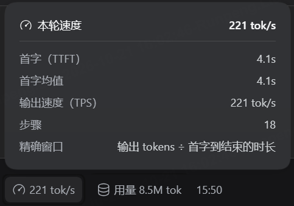

# dsh-simple-tps

[](https://awesome-dsh-plugin.com)


在 DSH 网页版的每轮回答下方显示该轮的首 token 延迟与输出速度。读数位于分支按钮之后、自带用量胶囊之前，点击展开明细弹窗。


点击读数展开明细：



插件由宿主与前端两部分组成。宿主持有一个会话投影，在完整事件日志上折叠出每轮指标；前端负责读取与呈现。

## 指标口径

一轮对话可能包含多个助手步骤，工具调用会把一轮拆成若干次模型请求。因此：

- **首字**：第一步的 TTFT，即首 token 时刻减该步开始时刻。它对应「按下回车之后等了多久模型才开口」。
- **均**：所有记录了首 token 的步骤的算术平均。只有一步时两者相等，只显示一个。
- **tok/s**：按 token 加权，即输出 token 总数除以解码总时长（各步消息完成时刻减首 token 时刻）。逐步平均会让短而快的步骤权重偏高，故不采用。

任一项取不到就省略该项，全部取不到则整条不渲染。

## 为什么在宿主侧计算

浏览器侧的会话快照只覆盖当前已加载的窗口，且首 token 时刻依赖 `assistant/live-chunk` 事件。该事件仅存在于实时流中，不写入持久日志。

持久日志里首 token 时刻另有来源。每条 `assistant/message` 携带 `data.stream`，其中的文本、推理与工具调用增量以「基准时刻 `time0` 加逐 token 间隔 `dt[]`」的形式压缩存放：整块 chunk 自带时间戳，成串的增量则只记录首项时刻与逐项间隔，靠累加还原。重放这份记录即可得到任意 token 的出现时刻，包括第一个。这一做法与 DSH 自带的 `sessionStats` 投影使用同一套事件语义，两者对首 token 的判定规则也一致。

投影因此能够覆盖完整日志，分页与压缩都不影响结果；刷新页面后历史轮次依然精确，不会退化为估算值。

前端保留窗口折叠作为兜底：投影不可用时退回读取节点的 `timing` 字段，速度改按整步时长计算，显示为 `≈45.0 tok/s` 并标注为下界。

## 前置条件

DSH 版本不低于 `0.2.1-rc.2`。宿主侧依赖 `sessionProjections` 服务，投影未注册时插件自身不激活。

## 安装

插件未发布到 npm，需要按 GitHub 仓库安装。

网页端和桌面客户端自带插件管理，在「设置 → 内置插件 → 添加插件」里填入仓库地址即可。

```text
https://github.com/flyxiu/dsh-simple-tps
```

命令行等价，`add` 之后的参数原样转给 pnpm：

```bash
dsh plugin --profile web add https://github.com/flyxiu/dsh-simple-tps
```

`github:flyxiu/dsh-simple-tps` 是 pnpm 针对 GitHub 简写的同义写法，两种写法装出来一样。

本地目录方式用于开发调试，改完代码不必推送即可生效：

```bash
dsh plugin --profile web add link:/path/to/dsh-simple-tps
```

区别在更新：仓库源会在插件市场显示更新按钮，`link:` 本地链接被排除在在线更新之外。

## 更新

插件市场比对仓库 HEAD 与用户 lockfile 中的 commit 判断是否有更新，因此在插件市场点击更新即可升级，不需要重新安装。`link:` 方式安装的副本不参与该检查。

## 开发

`lib/client.js` 是手写的模块加载器格式，无构建步骤：

```js
window.__ModuleLoader__.load({ id: 'dsh-simple-tps', factory: (require) => { ... } })
```

`id` 必须与包名一致。`require` 只能取平台模块表内的包，目前用到 `react`、`react-dom` 与 `@deepseek-ai/dsh-client-ui-primitives`；三者缺失时降级为纯文本显示，不阻断加载。

修改后的生效方式取决于改动位置：

```bash
dsh-restart      # 改动 lib/index.js（宿主投影）
# Ctrl+F5        # 改动 lib/client.js（前端）
```

没有热更新。客户端的 HMR 只在从源码 checkout 运行 `pnpm run dev:web` 时重建 bundle。

宿主与前端各自独立生效，改动其中一侧不影响另一侧。

## 测试

两套离线测试，不依赖运行中的 DSH：

```bash
node tests/run.mjs    # 前端：注册、折叠、投影优先、窄屏降级、数字格式化
node tests/host.mjs   # 宿主：流还原、多步折叠、真实日志比对
```

`tests/host.mjs` 在本机存在真实会话日志时会跑完整折叠，断言绝大多数轮次都能取到精确 TTFT。

用真实事件载荷验证，比构造假数据更能反映字段实情。

## 界面细节

读数通过 `conversation.chat.assistant-actions` 列表插槽注册。

该插槽在 DOM 上只能落在复制按钮之后、分支按钮之前，落不到用量与时间之间。那一格由 `MessageIconActions` 内联渲染，没有对外插槽。

视觉位置由 CSS `order` 调整。这里必须使用后代选择器而非子选择器：

```css
[data-clock=end] .dsh-simple-tps-root { margin-right: -8px; order: 5 }
[data-clock=end] > :last-child        { order: 10 }
```

插槽会在动作行与读数之间插入一层 `display: contents` 的容器，读数因此是孙节点，子选择器无法命中。`display: contents` 的元素不生成盒子，但不影响选择器匹配，后代选择器可以穿过它；这也是最初把位置改错的原因，写成 `>` 时规则始终不生效。

`-8px` 抵消用量组自带的左边距。

交互沿用自带用量胶囊的形态：默认只显示速度，点击展开明细。弹窗复用 `useAnchoredPosition` 与 `useDismissOnOutsidePointer` 两个原语，配色取自 `--dsw-specific-menu`、`--dsw-elevation-prominent` 等语义令牌，与自带的「本轮用量」弹窗同一套视觉。

位于动作行内，历史轮次上的读数与用量胶囊一样需要悬停才淡入。

## 实时速度

会话运行期间，当前流式输出的速度以「字/s」显示在「深度求索中」之后。该项独立于每轮读数，随回合结束消失。


客户端只能观察到增量文本，拿不到 token 计数——token 数要等整轮结束才随 `usage` 返回。实时项因此以字符数计速并标注单位为「字/s」，每轮读数仍为精确的 token 口径。

采样窗口取最近 1.2 秒。

输出停顿或计算条件不足时保留上一次读数，避免跳变。

## 卸载

```bash
dsh plugin --profile web remove dsh-simple-tps
dsh-restart
```

## 许可

MIT
